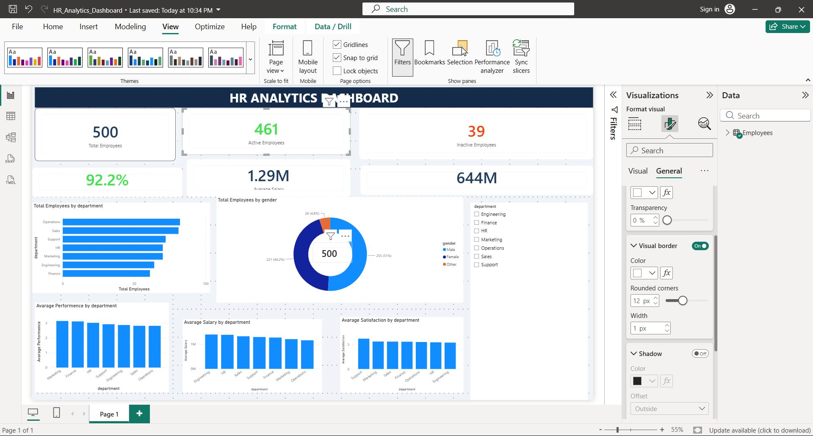

# 📊 HR Analytics Dashboard – Power BI
## 📸 Dashboard Preview

## 📌 Project Overview

An interactive HR Analytics Dashboard developed using Microsoft Power BI to analyze employee demographics, workforce distribution, salary, performance, and employee satisfaction.

## 🎯 Project Objectives

- Analyze employee workforce distribution.
- Monitor active and inactive employees.
- Analyze department-wise salary and performance.
- Understand employee satisfaction levels.
- Support data-driven HR decision-making.

## 🛠️ Tools & Technologies

- Microsoft Power BI Desktop
- DAX (Data Analysis Expressions)
- CSV Dataset
- Data Visualization
- Git & GitHub

## 📈 Key Performance Indicators

| KPI | Value |
|---|---:|
| Total Employees | 500 |
| Active Employees | 461 |
| Inactive Employees | 39 |
| Active Employee Rate | 92.2% |

## 📊 Dashboard Features

- Employee count by department
- Gender distribution
- Average salary by department
- Employee performance analysis
- Employee satisfaction analysis
- Interactive department filter
- KPI cards and donut chart

## 📂 Project Files

- HR_Analytics_Dashboard.pbix — Power BI Dashboard
- sample_data.csv — Employee Dataset
- README.md — Project Documentation

## 🚀 How to Run

1. Download or clone this repository.
2. Install Microsoft Power BI Desktop.
3. Open HR_Analytics_Dashboard.pbix.
4. Update the CSV source path if required.
5. Explore the dashboard using interactive filters.

## 💡 Skills Demonstrated

- Data Analytics
- Business Intelligence
- Data Visualization
- KPI Analysis
- Dashboard Development
- HR Analytics

## 👨‍💻 Author

**Krishna Solanke**

Aspiring Data Scientist | MCA Student

GitHub: https://github.com/krishna570

---

⭐ If you find this project useful, consider giving it a star!